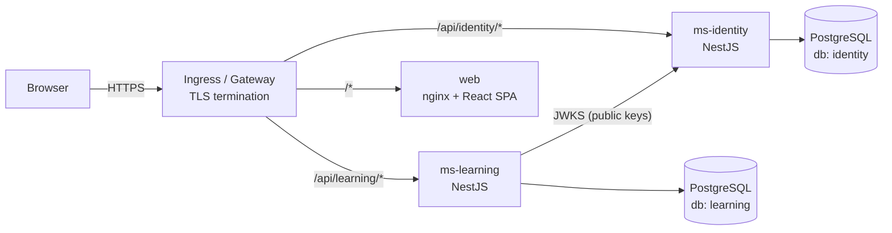
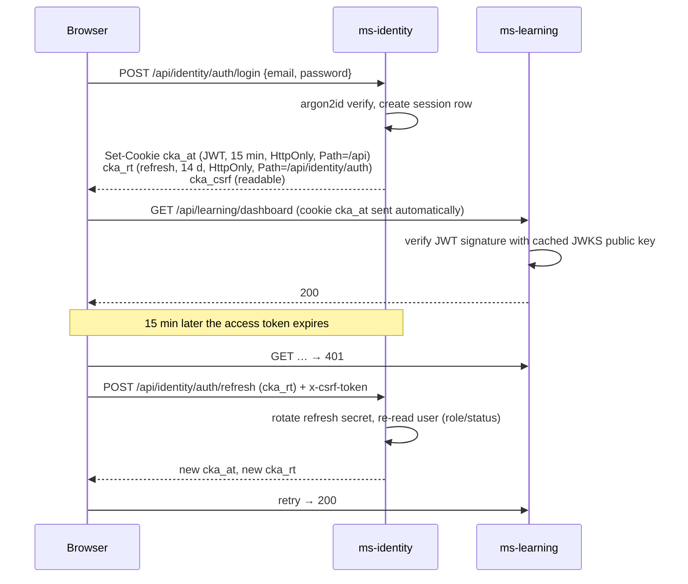

# Architecture

This document explains how CKA Lab is put together and **why**. Several decisions were made as much to practise production patterns as to serve a handful of users; each section says which.

## Overview



| Component | Responsibility | Tech | State |
|---|---|---|---|
| `web` | The UI. Lesson bodies are compiled into it. | React 19, MUI 7, RTK Query, React Router 7, MDX, Shiki, Mermaid; served by unprivileged nginx | none |
| `ms-identity` | Users, roles, invitations, password reset, sessions, **the only holder of the token-signing key** | NestJS 12, TypeORM, argon2, jose | `identity` database |
| `ms-learning` | Curriculum, progress, bookmarks, labs, quizzes (graded here), mock exams, dashboard | NestJS 12, TypeORM, zod, yaml | `learning` database + content baked into the image |
| PostgreSQL | Persistence. One server, **one database and one login role per service**. | PostgreSQL 17 | PVC / volume |

There is no API gateway service: path-based routing is the Ingress' job (and the Compose "edge" nginx in local runs). Both are configured with the same three rules.

## Why two services instead of one

A single NestJS app would have been simpler. The split was chosen deliberately as a learning exercise in operating microservices, and it is kept to boundaries that are real:

- **Different data with different sensitivity.** Password hashes and sessions live in a database that `ms-learning` cannot connect to.
- **Different failure impact.** If `ms-learning` is down, people can still sign in; if `ms-identity` is down, already signed-in users keep working until their access token expires (see below).
- **Different change rate.** Course features change often; auth should rarely change.

What we deliberately did **not** add: a message broker, a service mesh, a separate API gateway. None solve a problem this system has. (They are listed as future experiments in [LAB_ARCHITECTURE](LAB_ARCHITECTURE.md).)

## Authentication across services



Key properties:

- **Asymmetric tokens (EdDSA / Ed25519).** Only `ms-identity` has the private key. `ms-learning` fetches public keys from `ms-identity`'s JWKS endpoint (`/.well-known/jwks.json`, cluster-internal only) and caches them. A compromised `ms-learning` cannot mint sessions. Compare with a shared HS256 secret, where every service could.
- **No per-request call to identity.** Verification is local, so `ms-learning` keeps working through an `ms-identity` restart.
- **Trade-off — revocation latency.** Disabling a user revokes their sessions immediately, but an access token already issued stays valid until it expires (≤ 15 minutes, `ACCESS_TOKEN_TTL_SECONDS`). Refresh re-reads the user, so role changes also take effect within that window.
- **Refresh token rotation with reuse detection.** Each refresh replaces the secret; the previous one is accepted for 60 s (concurrent tabs), after that its use revokes the session.
- **Cookies, not localStorage.** Tokens are HttpOnly, so JavaScript — including injected script — cannot read them. Details in [SECURITY](SECURITY.md).

The shared logic lives in `packages/auth-kit`: a NestJS module that registers three global guards (CSRF → authentication → roles). Every route is protected by default; exceptions are explicit (`@Public()`, `@SkipCsrf()`).

## Data

Each service owns its schema and migrations (`apps/*/src/database/migrations`, plain SQL in TypeORM migration classes). There are **no foreign keys across services** — `ms-learning` stores `user_id` as a plain UUID. Consequences, accepted knowingly:

- Users are deactivated, never deleted, so learning data never points at nothing.
- If hard deletion is ever needed, it must be orchestrated across both services (application-level consistency).

Migrations run at service start-up behind a Postgres **advisory lock**, so several replicas starting together during a rolling update cannot apply the same migration twice. They can be disabled (`DATABASE_MIGRATIONS_RUN=false`) and run as a separate step instead.

### Tables

| Service | Table | Purpose |
|---|---|---|
| identity | `users` | email (lower-case, unique), display name, argon2id hash, role, status |
| identity | `sessions` | one per login: SHA-256 of the refresh secret, previous hash for rotation grace, expiry, revocation |
| identity | `user_tokens` | invitation and reset tokens (SHA-256 hashed, single use, expiring) |
| learning | `lesson_progress`, `lesson_visits`, `bookmarks` | reading progress |
| learning | `lab_progress` | completed tasks, revealed solutions |
| learning | `quiz_attempts` | answers and graded results |
| learning | `exam_attempts` | deadline, per-task states, score (unique index: one open attempt per exam) |

## Content pipeline

Course content is version-controlled under `content/` and **compiled into the images** — a given image tag is an exact, reproducible version of the course.

```
content/
  curriculum.yaml ──► ms-learning image (served as /api/learning/curriculum)
  labs/ quizzes/ exams/ cheatsheets/ ──► ms-learning image (answer keys never leave the server)
  lessons/<module>/<lesson>.mdx ──► web image (compiled to JS chunks, highlighted at build time)
```

- `ms-learning` validates everything with zod schemas at start-up and in its image build (`npm run content:check`): unknown keys, broken references, uncovered official competencies, published lessons without a body all fail the build.
- Lessons are MDX so they can use interactive components (`<Terminal>`, `<Diagram>`, `<Exercise>`, `<KnowledgeCheck>`…). Shiki highlights code at build time; Mermaid is loaded only on lessons with diagrams.

Changing content therefore means: edit files → commit → build images → deploy. No database migration, no admin UI. See [CONTENT_AUTHORING](CONTENT_AUTHORING.md).

## Frontend

The web app reuses the boilerplate's foundations — MUI theme structure, RTK Query with a single base query and deduplicated 401 refresh, navigation-as-data, the responsive drawer layout, the MDX + build-time index approach of the help center — adapted to cookie sessions and this domain. It talks only to same-origin `/api/...` paths; in development Vite proxies them, in production the Ingress routes them.

Notable choices:

- English only, no i18n layer (decided up front; strings are in components).
- Runtime config (`/config.js`, e.g. `APP_NAME`) is generated at container start, like the boilerplate, so one image serves every environment.
- Lesson bodies and the search index are separate lazy chunks; the initial bundle contains no course text.

## Runtime behaviour on Kubernetes

| Concern | How it is handled |
|---|---|
| Liveness vs readiness | `/healthz` (process alive, no dependencies) vs `/readyz` (database reachable). A DB outage removes Pods from Services instead of restart-looping them. |
| Slow first start | `startupProbe` covers migrations before liveness starts counting. |
| Rolling updates | `maxUnavailable: 0`, a 5 s `preStop` sleep so endpoint removal propagates before the process stops, Nest shutdown hooks drain in-flight requests. |
| Voluntary disruption | PodDisruptionBudgets (`maxUnavailable: 1`) for multi-replica components. |
| Placement | Topology spread across nodes. |
| Least privilege | non-root, read-only root filesystem, all capabilities dropped, `RuntimeDefault` seccomp, no ServiceAccount token mounted. |
| Network | NetworkPolicies: only the Ingress controller reaches the apps; only the services reach Postgres; only `ms-learning` reaches identity directly. |

## Decisions log

| Decision | Alternatives considered | Why |
|---|---|---|
| Copy a curated subset of the boilerplate | Fork it whole | 90 % of it is ERP code; keep its conventions, not its domain |
| NestJS + TypeORM | Fastify + Drizzle, Go | Your existing services used Express + TypeORM; Nest builds on both and adds structure |
| Two services + JWKS | Monolith; HS256 shared secret | Practise real service boundaries without a shared secret |
| Cookie sessions | JWT in localStorage (boilerplate) | XSS-resistant, required by the security brief |
| Content in git, compiled into images | CMS / runtime Markdown volume | Reproducible versions, rich components, answer keys stay server-side |
| Server-graded quizzes | Client-side grading | Answers never reach the browser before submission |
| Self-reported lab and exam checks | Automated validation now | Running commands against a user's cluster needs the isolated lab runner designed in LAB_ARCHITECTURE; we do not fake it |
| Ingress default + Gateway API option, tested with Traefik | ingress-nginx | ingress-nginx was retired by the Kubernetes project in 2026; the chart stays controller-neutral |
