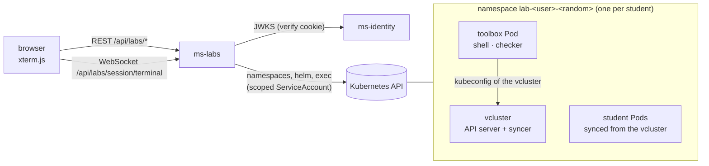

# Lab architecture

Every student gets a **private Kubernetes cluster in the browser**: start a lab, and within about a minute a terminal opens next to the instructions, the lab's broken (or empty) starting state is already applied, and **Check my work** verifies each task on the cluster itself. There is also a **Playground** (an empty cluster, from the sidebar or the terminal button on any page) to try lesson commands.

**Exercises** (`content/exercises`) use the playground too: opening one loads its starting state into the student's existing cluster in a few seconds — no new cluster per exercise.

Students can still do every lab on their own cluster instead: each lab page keeps the copy-paste setup, the checks, the verify script and the reset.

## How it works

| Piece | What it is |
|---|---|
| **ms-labs** (`apps/ms-labs`) | NestJS service. The only platform component with Kubernetes credentials. Creates and deletes sessions, runs lab setup and checks, bridges the terminal WebSocket to `kubectl exec`. Stateless: the session state lives on the namespace. |
| **Session** | One namespace per student (`lab-<hash of user id>-<random>`). Labels mark it as a session and record the owner; annotations hold the phase, lab, timestamps and check results. Deleting the namespace deletes everything. |
| **Virtual cluster** | [vcluster](https://www.vcluster.com) 0.37 (chart pinned and vendored in the ms-labs image): a real Kubernetes API server (v1.36) running as one Pod in the session namespace. The student is cluster-admin *of it*: namespaces, ClusterRoles, CRDs, PVs, nodes (virtual) — what CKA tasks need — without any rights on the real cluster. Pods they create are synced into the session namespace and run on the real nodes. |
| **Toolbox Pod** (`images/toolbox`) | Two containers from one image (bash, kubectl 1.36, helm, vim, jq, yq, curl, dig, `k` alias, `$do` and `$now` like in the exam). `shell` is the browser terminal. `checker` runs setup and checks; it has its own home and `/tmp`, so the student cannot tamper with what grades them, and mounts the student's home **read-only** at the same path to grade answer files and shell history. Both only hold the vcluster's kubeconfig. |
| **web** | Lab page = instructions left, terminal right. `▶` on code blocks pastes the command into the terminal. A terminal dock (top bar) opens the playground beside any page. Enabled with `LABS_ENABLED=true` (`labs.enabled` in Helm). |

### Session lifecycle

1. **Start** (`POST /api/labs/session {labId}`). One session per student: starting another lab deletes the previous one (its namespace terminates in the background). A global cap (`LABS_MAX_SESSIONS`) protects the cluster.
2. **Provisioning**: namespace → RoleBinding for ms-labs → ResourceQuota, LimitRange, NetworkPolicy → `helm upgrade --install` of the vcluster.
3. **Starting**: wait for the vcluster kubeconfig Secret, create the toolbox Pod, wait until the virtual API answers.
4. **SettingUp**: run the lab's `setup.commands` in `checker` (5 min timeout).
5. **Ready**: the browser opens the terminal. Typical total: 30–45 s with images cached.
6. **Checks**: `POST /session/tasks/:taskId/checks` runs the task's automatic checks in `checker` (30 s each) and stores the results on the namespace; `POST /session/verify` runs the lab's verify script.
7. **Reset** = delete the session and create a fresh one (the setup runs again). **End** deletes it.
8. **Expiry**: a sweeper in ms-labs (every minute) deletes sessions idle for `LABS_IDLE_MINUTES` (no terminal input or checks), older than `LABS_MAX_MINUTES`, or stuck before Ready for `LABS_PROVISION_TIMEOUT_MINUTES` — e.g. because the ms-labs replica provisioning them restarted.

### Exercises

1. **Load** (`POST /api/labs/session/exercise {exerciseId}`): needs a playground session; with none, it starts one (`POST /session {exerciseId}`) and loads the exercise when it is Ready. The namespace annotations record the exercise and its state (`Loading` → `Ready` | `Failed`).
2. In `checker`: delete the exercise's `namespaces` (force-deleting their Pods first, so this takes seconds), run `cleanup`, recreate the namespaces, run `setup`. In `shell`: replace `~/<exercise>/` with the starter files and remove stale answer files. Typical: 3–15 s.
3. **Validate** (`POST /session/exercise/validate {exerciseId, answers, terminal}`): runs every test case in order. `cluster`, `file` and `history` checks and `expectCommand` run in `checker`; answers and terminal text are compared in Node and never reach a shell. The response says pass/fail per check, with what the checker saw (never the expected answer). The browser then records the attempt in ms-learning, which marks the exercise solved.
4. **Reset exercise** = load it again. Loading a different exercise leaves the previous one's namespaces in place until that one is loaded again.

A load that never finishes (its ms-labs replica restarted) is reported as `Failed` after 6 minutes, and the student can load it again.

### Checks

A check is a read-only command and its expected output (see [CONTENT_AUTHORING](CONTENT_AUTHORING.md#labs-contentlabsidyaml)). With `match` set, ms-labs runs it and decides:

| `match` | Passes when |
|---|---|
| `exact` | trimmed stdout equals `expect` |
| `contains` | stdout contains `expect` |
| `regex` | stdout matches the regular expression `expect` |
| `success` | the command exits 0 |

Only commands written in the course content run — never text from a request. Checks without `match` (e.g. ones with placeholders like `<node-ip>`) stay "check yourself".

## Security

The design goal: **a student — or a bug in ms-labs — cannot affect anything outside their own session namespace.**

| Risk | Control |
|---|---|
| Platform compromise → cluster compromise | Only ms-labs has Kubernetes credentials. Its ClusterRole allows only: namespaces (create/patch/delete…), `create` RoleBindings, `bind` one ClusterRole (`session-owner`). It has **no** rights inside any namespace until it creates a session and binds `session-owner` *in that namespace*. Verified: it cannot read Secrets in the platform namespace or kube-system, nor exec into platform Pods. |
| A bug or injection in ms-labs | Two **ValidatingAdmissionPolicies** (`templates/labs.yaml`), matching only ms-labs' ServiceAccount: namespaces it creates/changes/deletes must be named `lab-*` and labelled `cka-lab/session=true` (it cannot label an existing namespace into scope, or remove the label); RoleBindings only inside session namespaces, and only to namespace Roles or `session-owner`. Tested by impersonation: creating `sneaky`, labelling `cka-lab`, deleting `traefik`, binding in `kube-system`, binding `cluster-admin` — all denied. |
| Student escapes to the real cluster | The student's API is the vcluster's, not the host's. The toolbox has no ServiceAccount token. The vcluster chart is installed without its ClusterRole (`rbac.clusterRole.enabled=false`). Session namespaces enforce Pod Security **baseline** (no privileged Pods, hostPath or host namespaces). |
| Student reaches other students or the platform over the network | Per-session NetworkPolicy: ingress only from the same namespace; egress to the same namespace, cluster DNS, the API server endpoint (for the syncer) and the internet — but not private ranges or cloud metadata (`169.254.0.0/16`). Verified from the shell and from a Pod inside the vcluster: platform services and Postgres unreachable by name and IP. Needs a CNI that enforces NetworkPolicy (kindnet does since kind 0.24). |
| Resource exhaustion | ResourceQuota per session (CPU/memory/Pods/Services/PVCs, no LoadBalancers), LimitRange defaults, global session cap, idle and hard expiry. |
| Terminal hijacking | The WebSocket handshake requires the access-token cookie (verified with ms-identity's public keys) **and** an `Origin` equal to `PUBLIC_URL` (browsers do not apply CORS to WebSockets; this is the CSRF defence). The target Pod is looked up from the token's user id — the request carries no session id. Max 4 terminals per user. Frames are validated (`input` / `resize` only, 64 KiB max). |
| Grading tampering | Checks run in the `checker` container (separate home and `/tmp`; the student's home is mounted read-only, as data to grade). Lab results are stored server-side on the namespace. Exercise `terminal` checks rely on text the browser sends, so they are practice-grade by design; the authoritative checks look at the cluster and at files. |
| Student input reaching a shell | Exercise answers (≤ 2,000 chars each) and terminal text (≤ 64 KB) are only compared in Node. Starter files are written base64-encoded; paths are validated in both services. |

### Known limitations

- **Node-level tasks** (kubeadm install/upgrade, etcd backup/restore, kubelet troubleshooting, static Pods) need real nodes; a virtual cluster has none. Labs with `environment.destructive: true` still run on the student's own cluster. Next step: disposable VMs (or kind-in-a-VM / KubeVirt) per session behind the same API.
- **NodePorts** are allocated on the real cluster: two students choosing the same fixed `nodePort` conflict.
- `kubectl run -i` / `attach` fall back to streaming logs inside a vcluster (output still appears).
- The vcluster runs Kubernetes 1.36 while the course targets 1.37 — update the chart when vcluster ships 1.37.
- Sessions run on the same cluster as the platform by default. For anything beyond a small private installation, run labs on a dedicated cluster (ms-labs only needs a kubeconfig: `LABS_KUBE_CONTEXT`, or mount one), so a noisy lab cannot starve the platform.
- The provisioning steps run in the ms-labs replica that received the request; keep `labs.replicas: 1` unless you add leader election.

## Running it

- **Kubernetes**: `labs.enabled: true` in Helm values, plus the `ms-labs` and `toolbox` images ([DEPLOYMENT](DEPLOYMENT.md)).
- **Development**: run ms-labs on your machine against a kind cluster ([DEVELOPMENT](DEVELOPMENT.md#hands-on-environments-ms-labs)).
- **Docker Compose**: not supported — sessions need a Kubernetes cluster.

## Ideas to practise on later

Not needed by the platform, but each is a good next DevOps exercise using it as the subject: a Redis-backed shared rate limiter; NATS events (e.g. "user deactivated" → learning data anonymisation, end lab sessions); OpenTelemetry traces across web → identity → learning → labs; a CloudNativePG cluster instead of the bundled PostgreSQL; image signing with cosign and admission verification; leader election for ms-labs.
