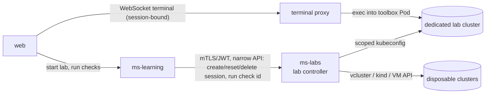

# Lab architecture

## Today: student-run labs (implemented)

Labs run **in the student's own terminal** against **their own cluster** (the course uses kind: `deploy/kind/cka-cluster.yaml`). The platform provides everything around the commands but executes nothing:

| Lab element | Where it lives | Notes |
|---|---|---|
| Scenario, objectives, environment requirements | `content/labs/<id>.yaml` | `destructive: true` labs show a warning to use a disposable cluster |
| Setup commands | same | Copy-paste, idempotent where possible |
| Tasks with hints | same | Hints are always visible on demand |
| Checks (`command` + `expect`) | same | Read-only commands the student runs to verify a task |
| Solutions | same, served only on request | Revealing is recorded (`lab_progress.revealed_solutions`); challenge and troubleshooting labs ask for confirmation |
| Verify script | same | Read-only bash that prints PASS/FAIL per objective |
| Reset | same | Removes everything the lab created |
| Progress | `ms-learning` database | Task completion is **self-reported** and labelled as such in the UI |

Every published lab was executed end to end on a kind v1.37 cluster (setup → failing verify → documented solution → passing verify → reset) before publication. This process caught real bugs in early drafts (an endpoint returning an empty body that a check expected to contain text). Keep doing it for every new lab.

What the platform deliberately does **not** claim: that a task "passed". It shows what the student reported.

## Future: platform-run labs (designed, not implemented)

The goal: start a lab in the browser, get an isolated environment, have tasks **validated automatically**, reset with one click — without giving the learning platform dangerous access to any cluster.

### Principles

1. **The learning services never get Kubernetes credentials.** Not cluster-admin, not namespaced — none. They only call the lab controller's narrow API.
2. **Browsers never receive kubeconfigs** for anything except the student's own disposable environment, and even that only through a terminal proxy, not a downloadable credential.
3. **No arbitrary command execution on shared infrastructure.** Validation runs predefined, read-only checks written in content, not commands supplied at run time.
4. **Blast radius matches the exercise.** Namespaced exercises get a namespace; cluster-level exercises (etcd restore, kubelet breakage, upgrades) get a disposable cluster.

### Components



| Component | Responsibility | Credentials |
|---|---|---|
| `ms-labs` (lab controller) | Owns lab sessions: create, expire, reset, delete; runs **predefined** checks | ServiceAccount on the **lab cluster** only, with a ClusterRole limited to: create/delete namespaces with a `cka-lab/session` label, and manage resources inside those namespaces. Separate credentials per disposable cluster. |
| Lab cluster | Hosts namespace-scoped sessions | Not the cluster that runs the platform |
| Disposable clusters | One per destructive session (vcluster for API-level isolation, kind or VMs for node-level tasks) | Created and destroyed by the controller |
| Toolbox Pod | Per session: kubectl, etcdctl, a shell; bound to a session ServiceAccount | RoleBinding only in the session namespace (or admin of its disposable cluster) |
| Terminal proxy | Bridges the browser to the toolbox Pod over WebSocket after checking the user's session and lab ownership | Exec permission on toolbox Pods only |

### Session lifecycle

1. Student clicks **Start lab**. `ms-learning` asks `ms-labs` for a session for `(user, lab)`.
2. `ms-labs` creates namespace `lab-<session-id>` with:
   - `ResourceQuota` (CPU, memory, Pods, Services, PVCs),
   - `LimitRange` (default requests/limits),
   - default-deny `NetworkPolicy` plus allow rules the lab declares,
   - Pod Security admission label `restricted` (or `baseline` if the lab needs it),
   - a session ServiceAccount + RoleBinding scoped to the namespace,
   - the lab's **setup** manifests (content gains a declarative `setup.manifests` field next to the shell commands).
3. The student works in the browser terminal (or downloads nothing — the toolbox is in-cluster).
4. **Check** buttons call `ms-labs` with a check id. The controller runs the check defined in content (initially: kubectl queries with JSONPath + expected values, evaluated by the controller, no shell) and returns pass/fail. `ms-learning` stores verified results — now the UI can honestly say *verified*.
5. **Reset** deletes and recreates the namespace. **Expiry** (e.g. 2 h idle, 4 h max) deletes it automatically; a TTL controller sweeps orphans.

### Destructive labs

Anything touching nodes or the control plane gets its own cluster:

- **vcluster** for exercises on API-level control plane behaviour (it has its own API server and etcd/SQLite),
- **kind in a VM** or real VMs for kubelet, container runtime, kubeadm upgrades and etcd restore — these need node access that a namespace can never provide.

Disposable clusters are created from a pre-baked image to keep start times under a minute, and destroyed on reset or expiry.

### Validation design

Checks become structured instead of free-form:

```yaml
checks:
  - id: has-endpoints
    description: The Service has two ready endpoints
    query:
      apiVersion: discovery.k8s.io/v1
      kind: EndpointSlice
      namespace: "{session}"
      labelSelector: kubernetes.io/service-name=catalog
      jsonPath: "{.items[*].endpoints[?(@.conditions.ready==true)].addresses[0]}"
    expect:
      count: 2
```

The controller evaluates them with its own client — no shell, no user input in commands. Checks that need traffic (an HTTP request through a Service) run as short-lived Jobs from a fixed probe image inside the session namespace.

### Security controls summary

| Risk | Control |
|---|---|
| Platform compromise → cluster compromise | Platform services hold no Kubernetes credentials; only `ms-labs` does, and only for lab clusters |
| Escaping a session namespace | Namespace RBAC, Pod Security restricted, NetworkPolicies, quotas; no hostPath/privileged in namespace labs |
| Resource exhaustion | ResourceQuota/LimitRange per session, cap on concurrent sessions per user and globally |
| Abandoned environments | Expiry + sweeper |
| Terminal hijacking | Terminal proxy validates the platform session and lab ownership on connect; sessions bound to one toolbox Pod |
| Credential leakage to browsers | Browser never receives a kubeconfig; the terminal is a proxied stream |

### Migration path

1. Add structured `query` checks alongside today's `command` checks in content (both shown to students).
2. Build `ms-labs` with namespace sessions only; enable for non-destructive labs.
3. Add the terminal proxy and toolbox image.
4. Add disposable clusters for destructive labs.
5. Mark labs as "auto-validated" in the UI only once their checks run server-side.

## Ideas to practise on later

These are not needed by the platform, but each is a good next DevOps exercise using it as the subject: a Redis-backed shared rate limiter; NATS events (e.g. "user deactivated" → learning data anonymisation); OpenTelemetry traces across web → identity → learning; a CloudNativePG cluster instead of the bundled PostgreSQL; image signing with cosign and admission verification.
